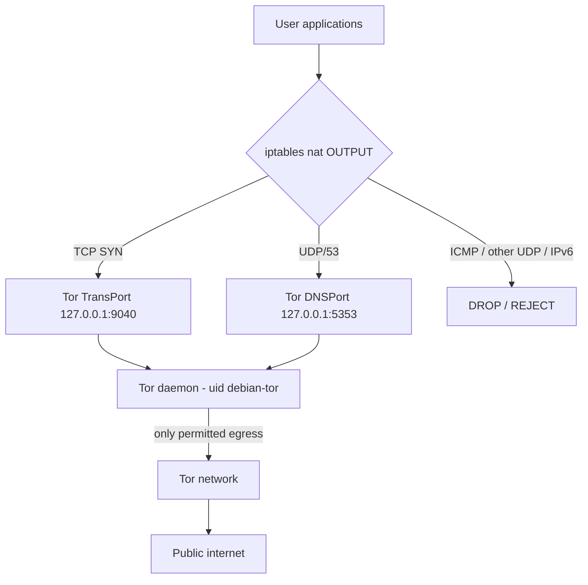

# Specter OS

**A Debian-based live Linux distribution that forces all network traffic through Tor.**

Specter OS boots from read-only media, runs entirely from RAM, and enforces transparent Tor routing at the kernel firewall level. A fail-closed kill-switch is in place before any network interface comes up. Nothing is written to the host machine, and every connection either goes through Tor or is dropped.

> **Status:** experimental research project. It has not been independently audited. Do not rely on it where anonymity failures carry real-world risk. See [Limitations](#limitations).

---

## Table of Contents

1. [Overview](#overview)
2. [Features](#features)
3. [Architecture](#architecture)
4. [Leak Protection Model](#leak-protection-model)
5. [Repository Layout](#repository-layout)
6. [Requirements](#requirements)
7. [Building the ISO](#building-the-iso)
8. [Testing](#testing)
9. [Verification](#verification)
10. [Limitations](#limitations)
11. [Roadmap](#roadmap)
12. [Documentation](#documentation)
13. [License](#license)
14. [Author](#author)

---

## Overview

Specter OS was built by hand from a `debootstrap` base rather than with an automated live-build framework. Every stage of the system (root filesystem, init ordering, firewall, compression, bootloader and ISO packaging) is explicit and documented. The project is modeled on the design ideas behind Tails and Whonix, and keeps its own minimal feature set.

## Features

| Area | Mechanism |
|---|---|
| Transparent proxying | All new outbound TCP connections are redirected by `iptables` NAT to Tor's `TransPort` (9040). No per-application configuration is required. |
| DNS leak protection | UDP/53 is redirected to Tor's `DNSPort` (5353). Hostnames are mapped into `10.192.0.0/10`. |
| Fail-closed kill-switch | Default `DROP` policy on every chain. Only the `debian-tor` user may open network connections. |
| IPv6 leak protection | IPv6 is disabled via sysctl and every `ip6tables` chain drops by default. |
| ICMP leak protection | Outbound ICMP is rejected, and echo requests are ignored. |
| Early-boot protection | The firewall unit runs with `DefaultDependencies=no` before `network-pre.target`, so there is no window between link-up and firewall activation. |
| Stream isolation | `IsolateClientAddr`, `IsolateDestAddr` and `IsolateDestPort` on the `TransPort`. |
| Amnesic live system | XZ-compressed SquashFS root, loaded into RAM by `live-boot`. |

## Architecture



Boot ordering:

```
firmware -> GRUB -> kernel + initrd -> live-boot mounts filesystem.squashfs
        -> systemd-sysctl (IPv6 off, ICMP hardening)
        -> tor-routing.service (default-deny firewall)   <- before network-pre.target
        -> NetworkManager (link up)
        -> tor.service
        -> desktop / user session
```

## Leak Protection Model

| Vector | Without protection | Specter OS behaviour |
|---|---|---|
| Plain TCP | Leaves via real IP | Redirected into Tor |
| DNS (UDP/53) | Sent to ISP resolver | Redirected to Tor DNSPort |
| Other UDP (QUIC, NTP, WebRTC) | Leaves via real IP | Rejected |
| ICMP (ping, traceroute) | Leaves via real IP | Rejected |
| IPv6 | Bypasses IPv4 firewall entirely | Disabled in kernel and dropped |
| Early boot window | Network up before firewall | Firewall applied before `network-pre.target` |
| Tor service crash | Traffic falls back to clearnet | Default DROP: connectivity stops, nothing leaks |

DHCP (UDP 67/68) is the only non-Tor traffic allowed. It is needed to obtain a LAN address and never leaves the local link.

## Repository Layout

```
Specter-OS/
├── config/
│   ├── torrc                        # /etc/tor/torrc
│   └── 99-specter-hardening.conf    # /etc/sysctl.d/
├── scripts/
│   └── tor-routing.sh               # /usr/local/bin/tor-routing.sh
├── systemd/
│   └── tor-routing.service          # /etc/systemd/system/
├── docs/
│   ├── Specter_OS_Development_Handbook.pdf
│   └── whitepaper/                  # IEEE-format white paper (LaTeX source + PDF)
├── LICENSE
└── README.md
```

## Requirements

* A Debian or Kali Linux build host with root access
* About 10 GB of free disk space
* Packages on the host: `debootstrap squashfs-tools xorriso grub-pc-bin grub-efi-amd64-bin grub-common qemu-system-x86`

## Building the ISO

### 1. Create the base system

```bash
sudo debootstrap stable ~/specter-os/chroot http://deb.debian.org/debian
```

### 2. Enter the chroot

```bash
for fs in dev proc sys run; do sudo mount --bind /$fs ~/specter-os/chroot/$fs; done
sudo cp /etc/resolv.conf ~/specter-os/chroot/etc/resolv.conf
sudo chroot ~/specter-os/chroot /bin/bash
```

### 3. Install packages (inside the chroot)

```bash
apt install linux-image-amd64 live-boot live-config tor iptables \
            network-manager macchanger curl nano sudo
```

### 4. Deploy the Specter OS configuration

From the repository, copy each file to its target path:

| Repository file | Target path |
|---|---|
| `config/torrc` | `/etc/tor/torrc` |
| `config/99-specter-hardening.conf` | `/etc/sysctl.d/99-specter-hardening.conf` |
| `scripts/tor-routing.sh` | `/usr/local/bin/tor-routing.sh` (mode `0755`) |
| `systemd/tor-routing.service` | `/etc/systemd/system/tor-routing.service` |

Then enable the services:

```bash
chmod 0755 /usr/local/bin/tor-routing.sh
systemctl enable tor-routing.service tor.service
```

For an additional early-boot safeguard, add `ipv6.disable=1` to the kernel command line in `grub.cfg`.

### 5. Clean up and leave the chroot

```bash
apt clean
rm -f /etc/resolv.conf /root/.bash_history
exit
for fs in run sys proc dev; do sudo umount ~/specter-os/chroot/$fs; done
```

### 6. Compress the filesystem and build the ISO

```bash
sudo mksquashfs ~/specter-os/chroot ~/specter-os/iso/live/filesystem.squashfs -noappend -comp xz -e boot
sudo grub-mkrescue -o ~/specter-os/specter-os.iso ~/specter-os/iso/
```

`grub-mkrescue` is used instead of assembling the image by hand with `xorriso -as mkisofs`. It builds the BIOS boot image, `core.img`, GRUB modules and the El Torito boot catalog consistently. An earlier manual build produced an invalid El Torito record ("Boot failed, could not read from CDROM").

## Testing

```bash
qemu-system-x86_64 -cdrom ~/specter-os/specter-os.iso -m 2048
```

## Verification

Run these inside the booted system:

```bash
# Traffic exits through Tor
curl https://check.torproject.org/api/ip          # expect "IsTor":true

# Kill-switch rules are loaded
sudo iptables -S && sudo ip6tables -S

# IPv6 is disabled
cat /proc/sys/net/ipv6/conf/all/disable_ipv6      # expect 1

# ICMP does not leave the machine
ping -c 1 -W 2 1.1.1.1                            # expect failure

# Firewall unit ran before the network
systemd-analyze critical-chain NetworkManager.service
```

When publishing output or screenshots, crop or blur interface addresses, MAC addresses, hostnames and boot logs.

## Limitations

* No application-level hardening. A browser can still be fingerprinted, so use Tor Browser for web traffic.
* UDP-based protocols other than DNS do not work, because Tor carries only TCP.
* Persistence, LUKS, UEFI and Secure Boot are not yet supported.
* Not audited. Treat it as a learning and research platform.

## Roadmap

* Persistent encrypted storage (LUKS)
* UEFI and Secure Boot support
* Automatic MAC address randomisation at boot
* AppArmor profiles and kernel hardening
* Reproducible builds

## Documentation

* **White paper (IEEE format):** [`docs/whitepaper/specter-os-whitepaper.pdf`](docs/whitepaper/specter-os-whitepaper.pdf), with the LaTeX source in the same folder
* **Development handbook:** [`docs/Specter_OS_Development_Handbook.pdf`](docs/Specter_OS_Development_Handbook.pdf), which covers the boot process, every tool used, and the errors met during development and how they were fixed

## License

Released under the GNU General Public License v3.0. See [`LICENSE`](LICENSE).

## Author

**Hamza Sajid**
GitHub: [github.com/HAMZOO0](https://github.com/HAMZOO0)
ORCID: [0009-0007-2231-9783](https://orcid.org/0009-0007-2231-9783)
