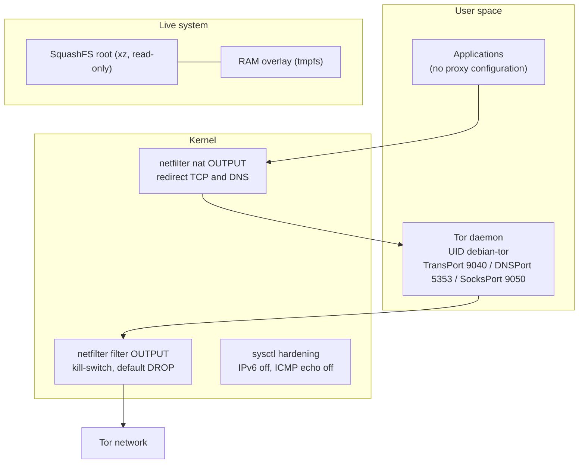
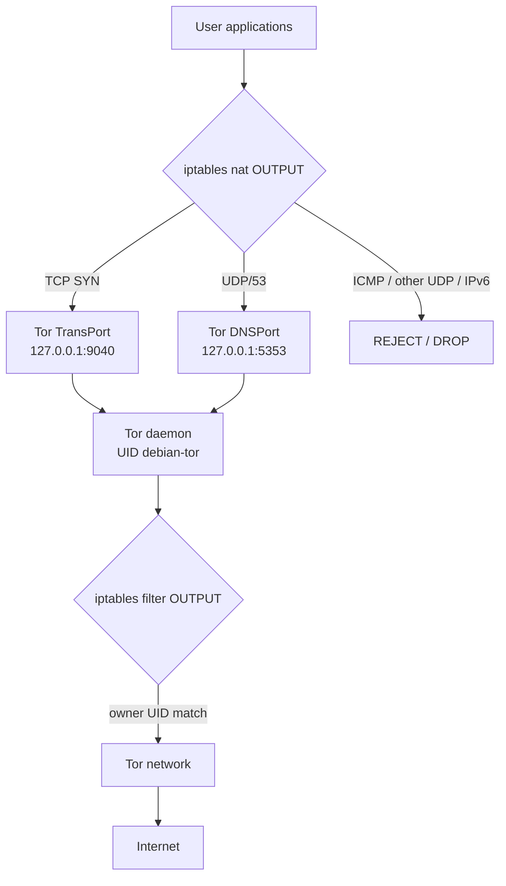
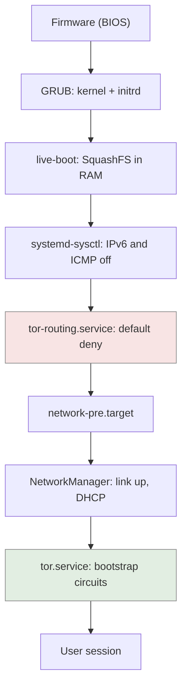

# Specter OS

**A fail-closed, transparently Tor-routed live Linux distribution.**

Specter OS is a Debian-based live operating system that boots from read-only media, runs entirely from RAM, and forces every network connection through the Tor network. Enforcement lives in the kernel packet filter, not in application settings, and it is in place before any network interface is configured. If Tor stops working, the system goes offline. It never falls back to the clearnet.

| | |
|---|---|
| **Paper** | *Specter OS: A Fail-Closed, Transparently Tor-Routed Live Linux Distribution* (preprint, 2026) |
| **DOI** | [10.5281/zenodo.24439519](https://doi.org/10.5281/zenodo.24439519) |
| **Zenodo record** | [zenodo.org/records/24439519](https://zenodo.org/records/24439519) |
| **Version** | 1.0 (November 2026) |
| **Base** | Debian 13 (stable), Linux 6.12, amd64 |
| **License** | GPL-3.0 (code), CC BY 4.0 (paper) |

> **Status:** experimental research project. It has not been independently audited. Do not rely on it where an anonymity failure carries real-world risk. See [Limitations](#limitations).

---

## Table of Contents

1. [Overview](#overview)
2. [Key Features](#key-features)
3. [Architecture](#architecture)
   - [System Layers](#system-layers)
   - [Outbound Packet Path](#outbound-packet-path)
   - [Boot Sequence](#boot-sequence)
   - [Firewall Rule Pipeline](#firewall-rule-pipeline)
4. [Threat Model](#threat-model)
5. [Leak Protection Model](#leak-protection-model)
6. [Technology Stack](#technology-stack)
7. [Configuration Reference](#configuration-reference)
8. [Repository Layout](#repository-layout)
9. [Requirements](#requirements)
10. [Building the ISO](#building-the-iso)
11. [Running and Testing](#running-and-testing)
12. [Verification](#verification)
13. [Evaluation Results](#evaluation-results)
14. [Limitations](#limitations)
15. [Roadmap](#roadmap)
16. [Documentation](#documentation)
17. [Citation](#citation)
18. [Security Notice](#security-notice)
19. [License](#license)
20. [Author](#author)

---

## Overview

Most failures of Tor-based anonymity do not come from attacks on the Tor protocol. They come from traffic that never entered Tor at all:

- DNS queries sent to the local resolver
- UDP protocols such as QUIC and WebRTC
- ICMP diagnostics
- IPv6 connections that bypass an IPv4-only proxy
- packets sent in the seconds between link-up and the start of the proxy

Specter OS closes these leaks at the operating-system level:

1. **Transparency:** applications need no proxy settings.
2. **Fail-closed behaviour:** if Tor is unavailable, the system is offline rather than exposed.
3. **No boot-time window:** enforcement exists before any interface obtains an address.
4. **Amnesia:** the system runs from a read-only compressed image in RAM and leaves no state on the host.
5. **Auditability:** the system is assembled by hand from a minimal `debootstrap` base, and the whole enforcement mechanism is small enough to read in full.

The design follows the single amnesic host model of Tails. Whonix and Qubes OS instead isolate Tor in a separate gateway virtual machine.

## Key Features

| Area | Mechanism |
|---|---|
| Transparent proxying | Every new outbound TCP connection is redirected by `iptables` NAT to Tor's `TransPort` (9040). |
| DNS leak protection | UDP/53 is redirected to Tor's `DNSPort` (5353). Hostnames, including `.onion`, are mapped into `10.192.0.0/10`. |
| Fail-closed kill-switch | Default `DROP` on every chain. Only the `debian-tor` user may open connections that leave the machine. |
| IPv6 leak protection | IPv6 is disabled through sysctl and every `ip6tables` chain drops by default. |
| ICMP and UDP leak protection | Outbound ICMP and non-DNS UDP are rejected. Echo requests are ignored. |
| Early-boot protection | The firewall unit runs with `DefaultDependencies=no`, ordered before `network-pre.target`. |
| Atomic, safe rule loading | All policies are set to `DROP` before any rule is flushed, and the script runs with `set -euo pipefail`. |
| Stream isolation | `IsolateClientAddr`, `IsolateDestAddr` and `IsolateDestPort` keep destinations on separate circuits. |
| Kernel hardening | No TCP timestamps, no redirects or forwarding, restricted `dmesg` and kernel pointers. |
| Amnesic live system | XZ-compressed SquashFS root, mounted under a RAM overlay by `live-boot`. All writes are lost at power-off. |

## Architecture

### System Layers



### Outbound Packet Path



Only three kinds of packet may leave a physical interface:
- new TCP connections owned by the `debian-tor` UID,
- replies on established flows, and
- DHCP on the local link.

### Boot Sequence



No network interface is configured until the kill-switch is in place. `network-pre.target` is passive, so the unit also declares `Wants=network-pre.target`, which pulls the target into the boot transaction.

### Firewall Rule Pipeline

`scripts/tor-routing.sh` builds the rule set in this order:

| Step | Table / chain | Rule | Purpose |
|---|---|---|---|
| 1 | all chains (v4 and v6) | policy `DROP` | Fail closed before anything is flushed |
| 2 | all tables | flush and delete chains | Start from a known state |
| 3 | sysctl | `disable_ipv6=1` | No IPv6 stack |
| 4 | `nat OUTPUT` | Tor UID: `RETURN` | Tor's own traffic is not redirected |
| 5 | `nat OUTPUT` | `udp --dport 53`: `REDIRECT 5353` | DNS into Tor |
| 6 | `nat OUTPUT` | `10.192.0.0/10` TCP: `REDIRECT 9040` | `.onion` and mapped hosts |
| 7 | `nat OUTPUT` | loopback: `RETURN` | Local services untouched |
| 8 | `nat OUTPUT` | `tcp --syn`: `REDIRECT 9040` | All other TCP into Tor |
| 9 | `filter OUTPUT` | `ctstate INVALID`: `DROP` | Block unproxied out-of-state packets |
| 10 | `filter OUTPUT` | `ESTABLISHED,RELATED`: `ACCEPT` | Replies |
| 11 | `filter OUTPUT` | Tor UID `tcp --syn`: `ACCEPT` | The only permitted egress |
| 12 | `filter OUTPUT` | loopback, DHCP 68 to 67: `ACCEPT` | Local and LAN address |
| 13 | `filter OUTPUT` | everything else: `REJECT` | Kill-switch |

## Threat Model

**Adversary:**
- A local network observer, such as an ISP, a Wi-Fi operator or a captive portal.
- A remote server that the user contacts.

**Goal:** learn the user's real IP address, or link the user's activity to their identity.

**Capabilities:**
- Observe every packet on the local link.
- Run a malicious destination server.
- Cause applications to emit non-TCP traffic, for example through WebRTC.

**Out of scope:**
- Global passive adversaries capable of end-to-end traffic correlation.
- Browser fingerprinting.
- Kernel or firmware compromise.
- Physical access to a running machine.

## Leak Protection Model

| Vector | Without protection | Specter OS behaviour |
|---|---|---|
| Plain TCP | Leaves via real IP | Redirected into Tor |
| DNS (UDP/53) | Sent to ISP resolver | Redirected to Tor `DNSPort` |
| Other UDP (QUIC, NTP, WebRTC) | Leaves via real IP | Rejected |
| ICMP (ping, traceroute) | Leaves via real IP | Rejected; echo replies disabled |
| IPv6 | Bypasses an IPv4 firewall | Disabled in kernel and dropped |
| Early-boot window | Network up before firewall | Firewall applied before `network-pre.target` |
| Tor process failure | Falls back to clearnet | Default `DROP`: connectivity stops |
| TCP timestamps | Reveal host uptime | `tcp_timestamps=0` |

DHCP (UDP 67/68) is the only non-Tor traffic allowed. It is needed to obtain a LAN address and never leaves the local link.

## Technology Stack

### Operating System Components

| Component | Role |
|---|---|
| Debian 13 (stable), amd64 | Base distribution |
| Linux kernel 6.12 (`linux-image-amd64`) | Kernel, netfilter, sysctl |
| systemd | Init system and early-boot ordering (`network-pre.target`) |
| `live-boot`, `live-config` | Locate and mount the SquashFS root under a RAM overlay |
| Tor 0.4.9 | Anonymity network client (`TransPort`, `DNSPort`, `SocksPort`) |
| `iptables` / `ip6tables` 1.8 (`nf_tables` backend) | NAT redirection and kill-switch |
| conntrack, owner match | Connection-state filtering, per-UID egress control |
| NetworkManager | Interface and DHCP management, started after the firewall |
| `macchanger` | MAC address randomisation (planned to be automatic) |

### Build Toolchain

| Tool | Role |
|---|---|
| `debootstrap` | Create the minimal Debian root filesystem |
| `chroot` | Install packages and configure the image |
| `squashfs-tools` (`mksquashfs`) | Compress the root filesystem with XZ |
| GRUB 2 (`grub-mkrescue`, `grub-pc-bin`) | Bootloader and El Torito boot image |
| `xorriso`, `mtools` | ISO 9660 image creation (used by `grub-mkrescue`) |

### Testing and Analysis

| Tool | Role |
|---|---|
| QEMU / KVM | Boot the ISO in a virtual machine |
| QEMU `filter-dump` | Capture every frame the virtual NIC emits, from outside the guest |
| `tcpdump` | Classify captured frames (ICMP, DNS, UDP, IPv6, TCP) |
| `curl`, `dig`, `ping`, `nc` | Leak probes inside the guest |
| `systemd-analyze` | Verify unit files and boot ordering |

### Documentation

| Tool | Role |
|---|---|
| LaTeX (`article`, `newtx`, TikZ, `listings`) | White paper typesetting and diagrams |
| Zenodo | Preprint hosting and DOI |

## Configuration Reference

### Tor client (`config/torrc`, installed to `/etc/tor/torrc`)

| Option | Value | Purpose |
|---|---|---|
| `SocksPort` | `127.0.0.1:9050` | SOCKS proxy for applications that support it |
| `TransPort` | `127.0.0.1:9040` + isolation flags | Receives NAT-redirected TCP |
| `DNSPort` | `127.0.0.1:5353` | Resolves redirected DNS through Tor |
| `VirtualAddrNetworkIPv4` | `10.192.0.0/10` | Virtual range for mapped hostnames |
| `AutomapHostsOnResolve` | `1` | Maps names, including `.onion` |
| `ClientUseIPv6` / `ClientPreferIPv6ORPort` | `0` | Tor never uses IPv6 relays |

### Kernel hardening (`config/99-specter-hardening.conf`, installed to `/etc/sysctl.d/`)

| Setting | Value | Purpose |
|---|---|---|
| `net.ipv6.conf.{all,default,lo}.disable_ipv6` | `1` | Disable the IPv6 stack |
| `net.ipv4.icmp_echo_ignore_all` | `1` | Do not answer ping |
| `net.ipv4.icmp_echo_ignore_broadcasts` | `1` | Ignore broadcast probes |
| `net.ipv4.conf.all.accept_redirects` / `send_redirects` | `0` | No ICMP redirects |
| `net.ipv4.conf.all.accept_source_route` | `0` | No source routing |
| `net.ipv4.ip_forward` | `0` | No forwarding |
| `net.ipv4.tcp_timestamps` | `0` | Do not reveal uptime |
| `kernel.kptr_restrict` | `2` | Hide kernel pointers |
| `kernel.dmesg_restrict` | `1` | Restrict the boot log to root |

### Firewall unit (`systemd/tor-routing.service`)

| Directive | Purpose |
|---|---|
| `DefaultDependencies=no` | Run in early boot |
| `After=local-fs.target systemd-sysctl.service` | Start after sysctl hardening |
| `Before=network-pre.target tor.service NetworkManager.service` | Rules exist before any interface is configured |
| `Wants=network-pre.target` | Pull the passive target into the boot transaction |
| `Type=oneshot`, `RemainAfterExit=yes` | Apply once and stay active |
| `WantedBy=sysinit.target` | Enabled as part of early system initialisation |

## Repository Layout

```
Specter-OS/
├── config/
│   ├── torrc                          # -> /etc/tor/torrc
│   └── 99-specter-hardening.conf      # -> /etc/sysctl.d/
├── scripts/
│   └── tor-routing.sh                 # -> /usr/local/bin/tor-routing.sh
├── systemd/
│   └── tor-routing.service            # -> /etc/systemd/system/
├── docs/
│   ├── Specter_OS_Development_Handbook.pdf
│   └── whitepaper/
│       ├── specter-os-whitepaper.tex  # LaTeX source
│       └── specter-os-whitepaper.pdf  # compiled paper
├── .gitattributes
├── .gitignore
├── LICENSE
└── README.md
```

## Requirements

- A Debian or Kali Linux build host with root access
- About 10 GB of free disk space and 2 GB of RAM
- Host packages:

```bash
sudo apt install debootstrap squashfs-tools xorriso mtools \
                 grub-pc-bin grub-common qemu-system-x86
```

## Building the ISO

### 1. Create the base system

```bash
sudo debootstrap stable ~/specter-os/chroot http://deb.debian.org/debian
```

### 2. Enter the chroot

```bash
for fs in dev proc sys run; do sudo mount --bind /$fs ~/specter-os/chroot/$fs; done
sudo cp /etc/resolv.conf ~/specter-os/chroot/etc/resolv.conf
sudo chroot ~/specter-os/chroot /bin/bash
```

### 3. Install packages (inside the chroot)

```bash
apt update
apt install linux-image-amd64 live-boot live-config systemd-sysv \
            tor iptables network-manager macchanger ca-certificates curl
```

### 4. Deploy the Specter OS configuration

Copy each repository file into the chroot:

| Repository file | Target path | Mode |
|---|---|---|
| `config/torrc` | `/etc/tor/torrc` | `0644` |
| `config/99-specter-hardening.conf` | `/etc/sysctl.d/99-specter-hardening.conf` | `0644` |
| `scripts/tor-routing.sh` | `/usr/local/bin/tor-routing.sh` | `0755` |
| `systemd/tor-routing.service` | `/etc/systemd/system/tor-routing.service` | `0644` |

Enable the services inside the chroot:

```bash
systemctl enable tor-routing.service tor.service NetworkManager.service
```

Optional: add `ipv6.disable=1` to the kernel command line to remove the IPv6 stack before user space starts.

### 5. Clean up and leave the chroot

```bash
apt clean
rm -f /etc/resolv.conf /root/.bash_history
exit
for fs in run sys proc dev; do sudo umount ~/specter-os/chroot/$fs; done
```

### 6. Compress the filesystem and build the ISO

```bash
mkdir -p ~/specter-os/iso/live ~/specter-os/iso/boot/grub
sudo cp ~/specter-os/chroot/boot/vmlinuz-*    ~/specter-os/iso/live/vmlinuz
sudo cp ~/specter-os/chroot/boot/initrd.img-* ~/specter-os/iso/live/initrd.img
sudo mksquashfs ~/specter-os/chroot ~/specter-os/iso/live/filesystem.squashfs \
     -noappend -comp xz -e boot
```

Create `~/specter-os/iso/boot/grub/grub.cfg`:

```
set timeout=5
set default=0
menuentry "Specter OS" {
    linux  /live/vmlinuz boot=live components quiet
    initrd /live/initrd.img
}
```

Build the hybrid ISO:

```bash
sudo grub-mkrescue -o ~/specter-os/specter-os.iso ~/specter-os/iso/
```

Use `grub-mkrescue` rather than assembling the image by hand. It builds the BIOS boot image, `core.img`, the GRUB modules and the El Torito boot catalog consistently. An earlier hand-built image failed with "Boot failed, could not read from CDROM".

### SquashFS compression options

| Algorithm | Characteristics |
|---|---|
| `xz` | Highest ratio, smallest image, slowest build (selected) |
| `zstd` | Good ratio, fast decompression |
| `gzip` | Balanced, universally supported |
| `lz4` | Fastest, lowest ratio |

## Running and Testing

Boot the ISO in QEMU:

```bash
qemu-system-x86_64 -enable-kvm -m 2048 -cdrom ~/specter-os/specter-os.iso
```

Record every frame the guest sends, as seen from outside the VM:

```bash
qemu-system-x86_64 -enable-kvm -m 2048 -cdrom ~/specter-os/specter-os.iso \
  -netdev user,id=n0 -device e1000,netdev=n0 \
  -object filter-dump,id=d0,netdev=n0,file=specter.pcap

tcpdump -nr specter.pcap 'icmp or ip6 or (udp and not port 67 and not port 68)'
```

On a hardened image, the `tcpdump` filter above should print nothing.

## Verification

Run inside the booted system:

```bash
# Traffic exits through Tor
curl https://check.torproject.org/api/ip          # expect "IsTor":true

# Kill-switch rules are loaded
sudo iptables -S && sudo ip6tables -S

# IPv6 is disabled
cat /proc/sys/net/ipv6/conf/all/disable_ipv6      # expect 1

# ICMP does not leave the machine
ping -c 1 -W 2 1.1.1.1                            # expect failure

# Firewall unit ran before the network
systemd-analyze critical-chain NetworkManager.service
systemd-analyze verify /etc/systemd/system/tor-routing.service

# Kill-switch: stop Tor, nothing should get out
sudo systemctl stop tor
curl -m 10 https://example.com                    # expect failure
```

If you publish output or screenshots, crop or blur interface addresses, MAC addresses, hostnames and boot logs.

## Evaluation Results

The initial and hardened images were built from the same Debian 13 base and booted under QEMU/KVM, with every frame captured by `filter-dump`. Results are from two boots per image. Full methodology is in the [paper](docs/whitepaper/specter-os-whitepaper.pdf).

| Test | Hardened image | Initial image |
|---|---|---|
| `ping` external host | 0/3 replies, 0 ICMP frames | 3/3 replies, 5 ICMP frames |
| IPv6 traffic | `disable_ipv6=1`, 0 frames | 14 IPv6 frames |
| DNS to external resolver | 0 UDP/53 frames | 0 UDP/53 frames |
| UDP probe (NTP) | 0 frames | 0 frames |
| Stop Tor, retry | No connectivity, 0 frames | Ping 2/2 replies, 4 frames |
| Boot order | Firewall 1.5 s before NetworkManager | NetworkManager 0.6 to 0.9 s before firewall |

In the test network, Tor stalled at 45 % bootstrap in both images because relay connections were reset. The rule counters confirm that all 194 of Tor's connection attempts were accepted by the firewall. End-to-end Tor checks, Tor DNS and latency could therefore not be measured in this evaluation.

## Limitations

- **Application layer:** a transparent proxy does not make applications anonymous. Use Tor Browser for web traffic.
- **Single-host enforcement:** an application running as root can rewrite the firewall. Gateway isolation, as in Whonix, is stronger.
- **UDP:** Tor carries only TCP, so non-DNS UDP services (VoIP, QUIC, games) do not work.
- **Hardware identifiers:** MAC randomisation is available but not yet enforced at boot.
- **Restrictive networks:** where Tor connections are reset, the system stays offline. Bridge support is not yet configured.
- **Evaluation scope:** tested in virtual machines only, not yet on physical hardware.
- **Not audited:** treat it as a learning and research platform.

## Roadmap

- Encrypted persistence with LUKS
- UEFI and Secure Boot support
- Automatic MAC randomisation before `network-pre.target`
- Tor bridge and pluggable transport support
- AppArmor confinement of user applications
- Migration of the rule set to `nftables`
- Reproducible builds

## Documentation

| Document | Description |
|---|---|
| [White paper (PDF)](docs/whitepaper/specter-os-whitepaper.pdf) | Design, threat model, implementation and evaluation |
| [White paper (LaTeX source)](docs/whitepaper/specter-os-whitepaper.tex) | Source of the paper |
| [Development handbook](docs/Specter_OS_Development_Handbook.pdf) | Boot process, every tool used, and the errors met during development |
| [Zenodo record](https://zenodo.org/records/24439519) | Archived preprint with DOI |

## Citation

If you use Specter OS or refer to this work, please cite the paper.

**IEEE:**

> H. Sajid, "Specter OS: A Fail-Closed, Transparently Tor-Routed Live Linux Distribution," Zenodo, preprint, Nov. 2026, doi: 10.5281/zenodo.24439519.

**BibTeX:**

```bibtex
@misc{sajid2026specteros,
  author       = {Sajid, Hamza},
  title        = {Specter {OS}: A Fail-Closed, Transparently Tor-Routed
                  Live Linux Distribution},
  year         = {2026},
  month        = nov,
  publisher    = {Zenodo},
  version      = {v1.0},
  doi          = {10.5281/zenodo.24439519},
  url          = {https://doi.org/10.5281/zenodo.24439519},
  note         = {Preprint}
}
```

## Security Notice

Specter OS is a research project. If you find a leak or a flaw in the rule set, please open an issue on this repository. Do not include your own IP address, MAC address or unredacted logs in the report.

## License

The source code is released under the GNU General Public License v3.0. See [`LICENSE`](LICENSE).
The white paper is released under the Creative Commons Attribution 4.0 International license.

## Author

**Hamza Sajid**
Department of Computer Science, NUST Balochistan Campus (NBC), National University of Sciences and Technology, Pakistan

- GitHub: [github.com/HAMZOO0](https://github.com/HAMZOO0)
- ORCID: [0009-0007-2231-9783](https://orcid.org/0009-0007-2231-9783)
