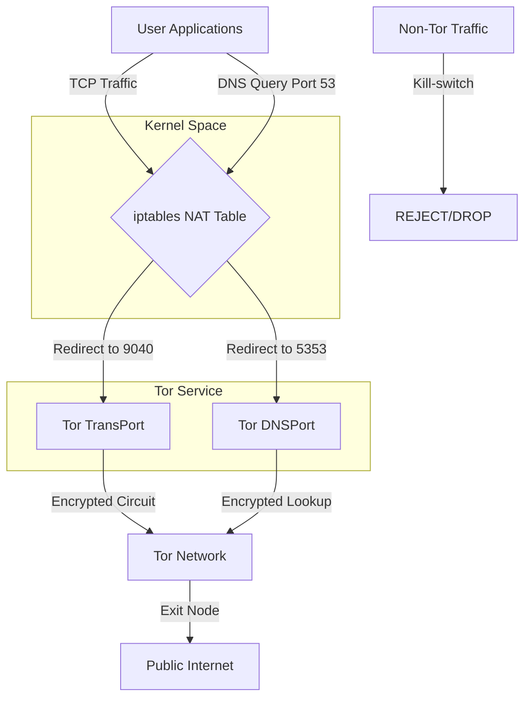

# 🛡️ Specter OS: Transparent Tor Proxy Live ISO

**Specter OS** is a custom, privacy-hardened Linux distribution built on a Kali/Debian base. It is designed for cybersecurity professionals and researchers who require a "Zero-Leak" environment where every single packet of network traffic is forced through the Tor network automatically at the kernel level.

## ✨ Key Features

* **Transparent Proxying**: Automatically routes all TCP and DNS traffic through Tor using `iptables` without needing `torsocks`.
* **Kernel-Level Kill-Switch**: Rejects any non-Tor traffic to prevent real IP leaks if the service drops.
* **DNS Leak Protection**: Forces all DNS queries to Tor's internal resolver on port 5353.
* **Hardened Boot Sequence**: Custom `systemd` services ensure the firewall is active before the desktop environment loads.
* **Live-System Optimized**: Built using XZ-compressed SquashFS for high-performance execution entirely from RAM.

---

## 🏗️ System Architecture

The following diagram illustrates how Specter OS intercepts local traffic and tunnels it through the Tor network:



---

## 🛠️ Installation & Build Process

Follow these steps to build the ISO from your Kali Linux host.

### 1. Environment Preparation

Mount the necessary host filesystems to the chroot directory to allow service management:

```bash
sudo mount --bind /dev ~/specter-os/chroot/dev
sudo mount --bind /proc ~/specter-os/chroot/proc
sudo mount --bind /sys ~/specter-os/chroot/sys
sudo mount --bind /run ~/specter-os/chroot/run
sudo cp /etc/resolv.conf ~/specter-os/chroot/etc/resolv.conf
sudo chroot ~/specter-os/chroot /bin/bash
```

### 2. Configure Tor for Transparency

Edit `/etc/tor/torrc` inside the chroot and add these lines to enable the proxy hooks:

```text
VirtualAddrNetworkIPv4 10.192.0.0/10
AutomapHostsOnResolve 1
TransPort 9040
DNSPort 5353
```

### 3. Deploy the Routing Engine

Create the firewall script at `/usr/local/bin/tor-routing.sh`, make it executable, and confirm it includes the `debian-tor` escape rule so Tor's own traffic is not redirected into itself:

```bash
chmod +x /usr/local/bin/tor-routing.sh
```

The script (also included in this repo under `scripts/tor-routing.sh`) looks up the Tor user's UID, allows Tor's own traffic and loopback traffic to pass untouched, redirects DNS to port 5353 and TCP to port 9040, and drops any UDP traffic that was not already redirected, to prevent leaks.

### 4. Set Up the Boot Service

Enable both Tor and the custom routing service so the firewall is active before anything else starts:

```bash
systemctl enable tor.service
systemctl enable tor-routing.service
```

The unit file is included in this repo under `systemd/tor-routing.service`. It runs the routing script once at boot as a oneshot service, after the network and Tor targets are ready.

### 5. Final ISO Compression

Exit the chroot, then compress the filesystem and build the bootable ISO:

```bash
# Compress the filesystem
sudo mksquashfs ~/specter-os/chroot ~/specter-os/live/filesystem.squashfs -noappend -comp xz

# Build the bootable ISO
sudo grub-mkrescue -o ~/specter-os/specter-os.iso ~/specter-os/iso/
```

`grub-mkrescue` is used here rather than a manual `xorriso -as mkisofs` build, since it automatically assembles the BIOS boot image, core.img, GRUB modules, and the El Torito boot catalog correctly. An earlier manual attempt at building the boot image produced an invalid El Torito record and the ISO failed to boot in QEMU with a "Boot failed, could not read from CDROM" error, which grub-mkrescue resolved.

---

## 🧪 Testing

Test the ISO in a virtual machine before writing it to a physical USB drive:

```bash
qemu-system-x86_64 -cdrom ~/specter-os/specter-os.iso -m 2048
```

---

## 🔍 Verification

Once booted, verify the connection status:

```bash
curl https://check.torproject.org/api/ip
```

Expected result: `{"IsTor":true}`

---

## 📸 Screenshots


---

## 📄 Documentation

A full development handbook covering the Linux boot process, every tool used with install commands, firewall rules, SquashFS, GRUB, ISO creation, and a complete list of errors encountered during development along with their fixes is included in `docs/Specter_OS_Development_Handbook.pdf`.

## 🗺️ Roadmap

* Persistence support so files and settings survive a reboot on the USB drive
* LUKS encryption for the persistent storage area
* UEFI boot support alongside the existing BIOS boot path
* Secure Boot compatibility
* Automatic package updates for the live system
* Kernel hardening and mandatory access control using AppArmor or SELinux
* Full leak protection covering DNS, UDP, and IPv6, similar in approach to Tails and Whonix

## ⚠️ Disclaimer

This project is intended for learning about Linux internals, system privacy, and Tor networking. It is a personal, in progress project and has not yet been audited or reviewed for security guarantees. It should not be relied on as a finished, production grade anonymity tool.

## 📜 License

This project is licensed under the MIT License. See the `LICENSE` file for details.

## 👤 Author

**Hamza Sajid**
Email: github.com/HAMZOO0
