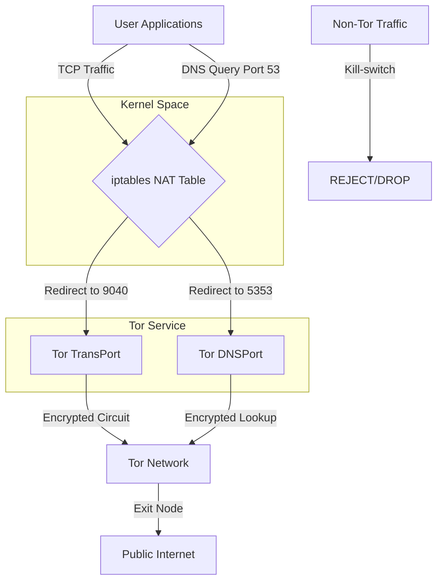

# 🛡️ Specter OS: Transparent Tor Proxy Live ISO

**Specter OS** is a custom, privacy-hardened Linux distribution built on a Kali/Debian base. It is designed for cybersecurity professionals and researchers who require a "Zero-Leak" environment where every single packet of network traffic is forced through the Tor network automatically at the kernel level.

## ✨ Key Features

* **Transparent Proxying**: Automatically routes all TCP and DNS traffic through Tor using `iptables` without needing `torsocks`.
* **Kernel-Level Kill-Switch**: Rejects any non-Tor traffic to prevent real IP leaks if the service drops.
* **DNS Leak Protection**: Forces all DNS queries to Tor's internal resolver on port 5353.
* **Hardened Boot Sequence**: Custom `systemd` services ensure the firewall is active before the desktop environment loads.
* **Live-System Optimized**: Built using XZ-compressed SquashFS for high-performance execution entirely from RAM.

---

## 🏗️ System Architecture

The following diagram illustrates how Specter OS intercepts local traffic and tunnels it through the Tor network:



---

## 🛠️ Installation & Build Process

Follow these steps to build the ISO from your Kali Linux host.

### 1. Environment Preparation

Mount the necessary host filesystems to the chroot directory to allow service management:

```bash
sudo mount --bind /dev ~/specter-os/chroot/dev
sudo mount --bind /proc ~/specter-os/chroot/proc
sudo mount --bind /sys ~/specter-os/chroot/sys
sudo chroot ~/specter-os/chroot /bin/bash

```

### 2. Configure Tor for Transparency

Edit `/etc/tor/torrc` inside the chroot and add these lines to enable the proxy "hooks":

```text
VirtualAddrNetworkIPv4 10.192.0.0/10
AutomapHostsOnResolve 1
TransPort 9040
DNSPort 5353

```

### 3. Deploy the Routing Engine

Create the firewall script at `/usr/local/bin/tor-routing.sh` and make it executable:

```bash
chmod +x /usr/local/bin/tor-routing.sh
# Ensure the script includes the 'debian-tor' escape rule

```

### 4. Set Up the Boot Service

Enable the custom firewall service to ensure privacy starts at boot time:

```bash
systemctl enable tor.service
systemctl enable tor-firewall.service

```

### 5. Final ISO Compression

Exit the chroot and use `xorriso` to "bake" the final bootable image:

```bash
# Compress the filesystem
sudo mksquashfs ~/specter-os/chroot ~/specter-os/iso/live/filesystem.squashfs -noappend -comp xz

# Generate the Hybrid ISO
sudo xorriso -as mkisofs -iso-level 3 -full-iso9660-filenames \
  -volid "SPECTER_OS_V1" -eltorito-boot boot/isolinux/isolinux.bin \
  -eltorito-catalog boot/isolinux/boot.cat -no-emul-boot \
  -isohybrid-mbr $(find /usr -name isohdpfx.bin | head -n 1) \
  -output ~/specter-os/SpecterOS-Final.iso ~/specter-os/iso/

```

---

## 🔍 Verification

Once booted, verify the connection status:

```bash
curl https://check.torproject.org/api/ip

```

Expected: `{"IsTor":true}`.

---


